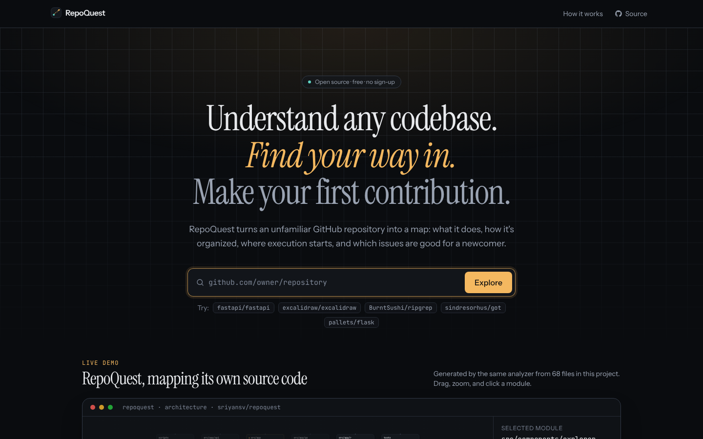
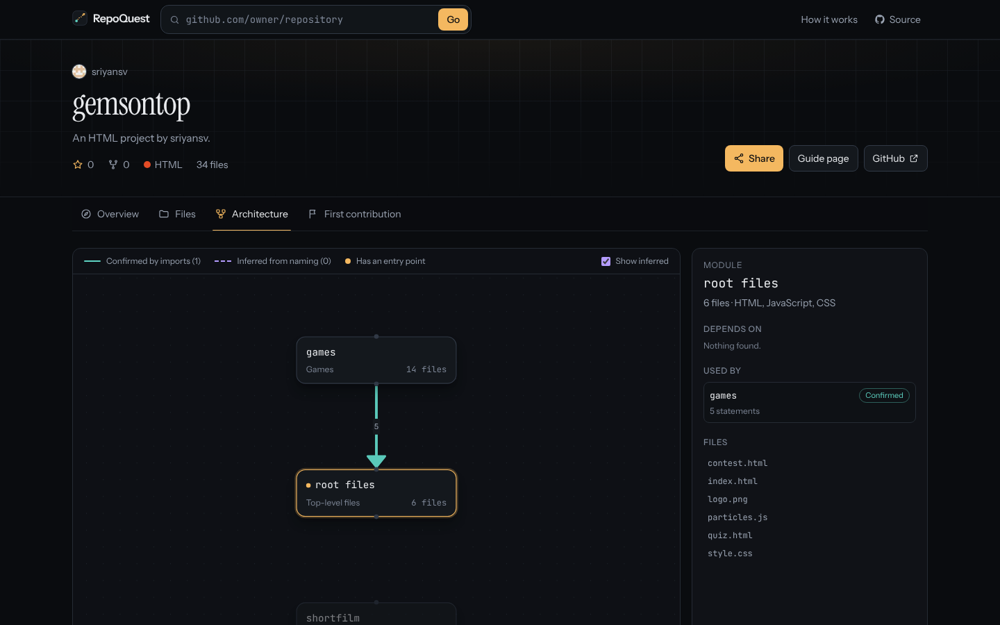
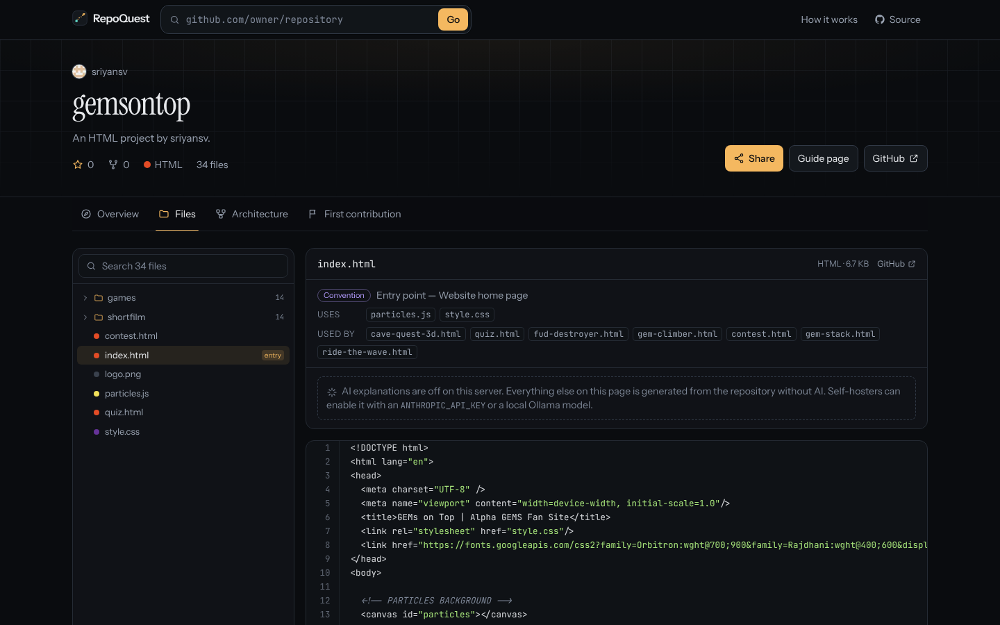

<div align="center">

# RepoQuest

**Understand any codebase. Find your way in. Make your first contribution.**

RepoQuest turns an unfamiliar public GitHub repository into a map: what it does, how it's organized, where execution starts, and which open issues are realistic for a newcomer.

[](https://github.com/sriyansv/repoquest/actions/workflows/ci.yml)
[](LICENSE)

[Features](#features) · [Quick start](#quick-start) · [How it works](#how-it-works) · [Configuration](#configuration) · [Deploy](#deploy-to-vercel) · [Contributing](CONTRIBUTING.md) · [Roadmap](ROADMAP.md)

</div>



| Architecture map | File explorer |
|---|---|
|  |  |

---

## Why

Opening a new repository is like arriving in a city with no map. There are hundreds of files and no sign of which one runs first. READMEs explain installation, not how the parts depend on each other. And "good first issue" labels are often stale, vague, or already taken.

RepoQuest is built for **beginner developers, students, and first-time open-source contributors**. It is also built to be trusted by them: it never presents a guess as a fact.

## Features

| | |
|---|---|
| **Repository importer** | Paste any public GitHub URL (full URL, `/tree/...` link, `owner/repo`, or SSH form). Metadata, README, the full file tree, and a sample of up to 80 source files are fetched, with rate-limit handling and large-repo truncation. |
| **Codebase explorer** | File tree with search, language colours, entry-point badges, highlighted source preview, and per-file "uses / used by" links. Deep links like `?tab=files&path=src/index.ts` work. |
| **Architecture map** | An interactive [React Flow](https://reactflow.dev) diagram of modules (folders) and their dependencies. You can pan, zoom, and click it. **Solid teal arrows are confirmed** by real `import` / `require` / `#include` / `<script>` statements. **Dashed violet arrows are inferred** from folder names. Click a module to see the exact statements behind each arrow. |
| **Grounded explanations** | A summary built only from facts found in the repository. Every sentence links to its source file. It works with **no AI at all**. |
| **Optional AI explanations** | "Explain this repository / this file" via Claude (or a free local model through Ollama). The model sees only files fetched from the repo and is instructed to say when something isn't shown. |
| **First-contribution assistant** | Open issues are assessed on their labels **and** their content: description quality, assignees, blocking labels, staleness, and claimed work. Each issue shows the reasoning, possibly relevant files (marked *mentioned* or *keyword guess*), what to understand first, and a link to the original. |
| **Shareable guide pages** | `/r/owner/repo/guide` is a clean, responsive, print-friendly page with the architecture and key facts, plus generated social preview images. |

Supported for import analysis: JavaScript/TypeScript (incl. `tsconfig` path aliases), Python, Go, Rust, Java/Kotlin/Scala, C/C++, Ruby, HTML, CSS/SCSS. Language statistics cover 50+ languages.

## Quick start

Requires **Node.js ≥ 20.9**.

```bash
git clone https://github.com/sriyansv/repoquest
cd repoquest
npm install
cp .env.example .env.local   # optional: add GITHUB_TOKEN
npm run dev
```

Open <http://localhost:3000> and paste a repository URL.

### Demo walkthrough

1. On the home page, scroll to **Live demo**. It shows RepoQuest's analysis of its *own* source, generated by the same analyzer (`npm run demo:build`). Click `src/components/explorer` to see what it depends on.
2. Paste `https://github.com/pallets/flask` (or any public repo) and press **Explore**.
3. **Overview**: read the source-cited summary, the traced execution flow, and the run commands. Click any grey source chip to open that file.
4. **Files**: search for a file, open it, and follow the *Uses / Used by* links.
5. **Architecture**: toggle *Show inferred*, click a module, and inspect the file-level evidence.
6. **First contribution**: filter to *Good first* and expand an issue to see why it was rated that way.
7. Click **Share** to copy a link to the guide page.

## How it works

```
GitHub REST API ──► importer (src/lib/github) ──► pure analysis (src/lib/analysis) ──► Server Components ──► client UI
 repo, tree,        ~6 API calls per repo,         languages · entry points ·          cached 30 min          tabs, React Flow,
 readme, issues     files via raw.githubusercontent imports · graph · summary · issues                           file preview
```

* **Confirmed vs inferred.** An edge is *confirmed* only if a statement in an analyzed file resolves to a file that exists in the tree. Unresolvable imports are counted as external packages or ignored, never guessed. *Inferred* edges come only from naming conventions (e.g. `tests/` → main module) and are labelled as such everywhere.
* **Sources everywhere.** Summary facts carry a `source` (README path, `package.json`, the GitHub API…). Entry points are marked *Confirmed* (declared in a manifest) or *Convention* (matched a well-known filename).
* **Issues are read, not filtered.** An issue is only called a *good first issue* if it has a positive signal (label), a usable description, and no blockers (assignee, `needs discussion`, locked…).
* **No paid service is required.** Without `ANTHROPIC_API_KEY`, everything except the optional AI buttons works.

See [docs/ARCHITECTURE.md](docs/ARCHITECTURE.md) for the full design.

## Configuration

All variables are optional and **server-side only** (see [`.env.example`](.env.example)).

| Variable | Purpose |
|---|---|
| `GITHUB_TOKEN` | A GitHub token (no scopes needed). Raises the API limit from 60 to 5,000 requests/hour. **Recommended in production.** |
| `ANTHROPIC_API_KEY` | Enables AI explanations through Claude. |
| `AI_PROVIDER` | `anthropic`, `ollama`, or `none`. |
| `AI_MODEL` | Model id. Default `claude-opus-5-5` (Anthropic) / `llama3.1` (Ollama). For lower cost, use a smaller model such as `claude-haiku-5-5`. |
| `OLLAMA_BASE_URL` | Local Ollama server for free, offline explanations. |
| `AI_RATE_LIMIT_PER_HOUR` | AI requests per client IP per hour, per server instance (default 20). |
| `NEXT_PUBLIC_SITE_URL` | Canonical URL for metadata and social cards. |
| `NEXT_PUBLIC_REPO_URL` | Source link shown in the header and footer. |

Each repository analysis costs about **6 GitHub API calls** (metadata, tree, README, languages, 2× issues). File contents are read from `raw.githubusercontent.com`, and results are cached for 30 minutes.

## Deploy to Vercel

1. Import the repository in Vercel (free Hobby plan works). The framework is detected automatically.
2. Add `GITHUB_TOKEN` (strongly recommended) and optionally `ANTHROPIC_API_KEY` as environment variables.
3. Deploy. `vercel.json` raises the AI route's time limit to 120 s.

Any Node host works too: `npm run build && npm start`.

## Scripts

| Command | |
|---|---|
| `npm run dev` | Development server |
| `npm run build` / `npm start` | Production build / server |
| `npm run lint` · `npm run typecheck` | ESLint · TypeScript |
| `npm test` | Unit tests (Vitest), no network |
| `npm run test:live` | Smoke test against the real GitHub API |
| `npm run demo:build` | Regenerate the landing-page demo from this repo's own source |

## Known limitations

* Import analysis is regex-based (no full parser), and reads a sample of up to 80 files per repo, so some edges can be missing. It never invents edges, but absence of an arrow is not proof of independence.
* Dynamic imports with computed paths, reflection, dependency injection, and monorepo package-name imports (`@org/pkg` → `packages/pkg`) are not yet resolved. See [ROADMAP.md](ROADMAP.md).
* Linked pull requests for issues aren't checked (that would need extra API calls per issue).
* The AI rate limiter is in-memory per server instance. Use a shared store for a hard global limit.
* Only public repositories on github.com are supported.

## Contributing

Contributions are very welcome, especially from first-time contributors. Project status and history: [docs/PROJECT_STATUS.md](docs/PROJECT_STATUS.md), [docs/DEVELOPMENT_LOG.md](docs/DEVELOPMENT_LOG.md). Read [CONTRIBUTING.md](CONTRIBUTING.md) and our [Code of Conduct](CODE_OF_CONDUCT.md). Security issues: see [SECURITY.md](SECURITY.md).

## License

[MIT](LICENSE). RepoQuest is not affiliated with GitHub.
